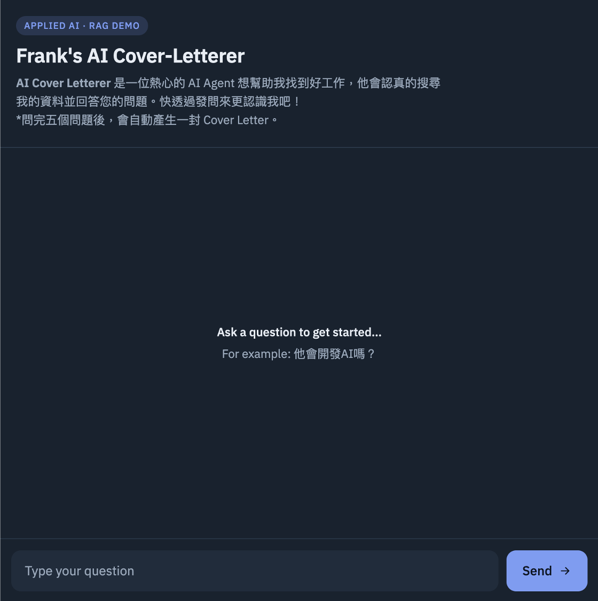

## Frank's AI Cover Letterer
Link: https://cover-letterer.frank-career-match.workers.dev/

**How to deploy it from scratch?**

**0. Create a Cloudflare account (in the browser)**

Go to https://dash.cloudflare.com/sign-up and register with an email and a password.

**1. Install the tools**

Need three things: **Node.js** (for Wrangler, Cloudflare's CLI), **git**, and **uv** (for Python dependencies).

**macOS** (with [Homebrew](https://brew.sh)):
```bash
brew install node git uv
```

Check that everything installed:
```bash
node -v && git --version && uv --version
```

**2. Get the code**

```bash
git clone https://github.com/Yangruto/cover-letterer
cd cover-letterer
```

**3. Log in to Cloudflare**

```bash
uv sync
npx wrangler login
```
A browser tab opens. Click **Allow**, and the terminal confirms. Check with:
```bash
npx wrangler whoami
```

**4. Test locally**

Create a file named `.dev.vars` in the repo root (this is for local testing only):
```
GOOGLE_API_KEY=pk-lf-... (LLM API KEY)
Qdrant_API_KEY=sk-lf-...
CLOUDFLARE_TOKEN=sk-...
```
Keep **secrets** out of git:
```bash
echo ".dev.vars" >> .gitignore
```
Start the local server:
```bash
uv run pywrangler dev
```
Open http://localhost:8787 and ask a question. Stop the server with `Ctrl+C`.

**5. Deploy**

```bash
uv run pywrangler deploy
```
The last line prints the URL, like `https://cover-letterer.<name>.workers.dev`.

**6. Add production secrets**

`.dev.vars` is not uploaded, so set each secret on Cloudflare. Each command prompts ask to paste the value:
```bash
npx wrangler secret put GOOGLE_API_KEY
npx wrangler secret put Qdrant_API_KEY
npx wrangler secret put CLOUDFLARE_TOKEN
```
Use the same names as in the `ENV_KEYS` list in `worker.py`.

**7. Test the live site**

```bash
curl https://cover-letterer.<name>.workers.dev/api/health
```
Should get `{"status":"ok"}`. Then open the URL in a browser and chat.

**8. Debugging and updating**

Watch live logs:
```bash
npx wrangler tail
```
After changing code, redeploy:
```bash
uv run pywrangler deploy
```

<p align="center">

</p>

*The process came from Claude and was modified myself.
